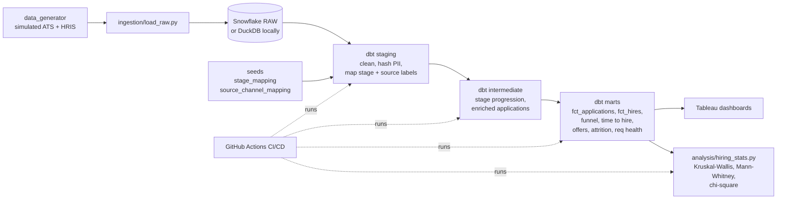
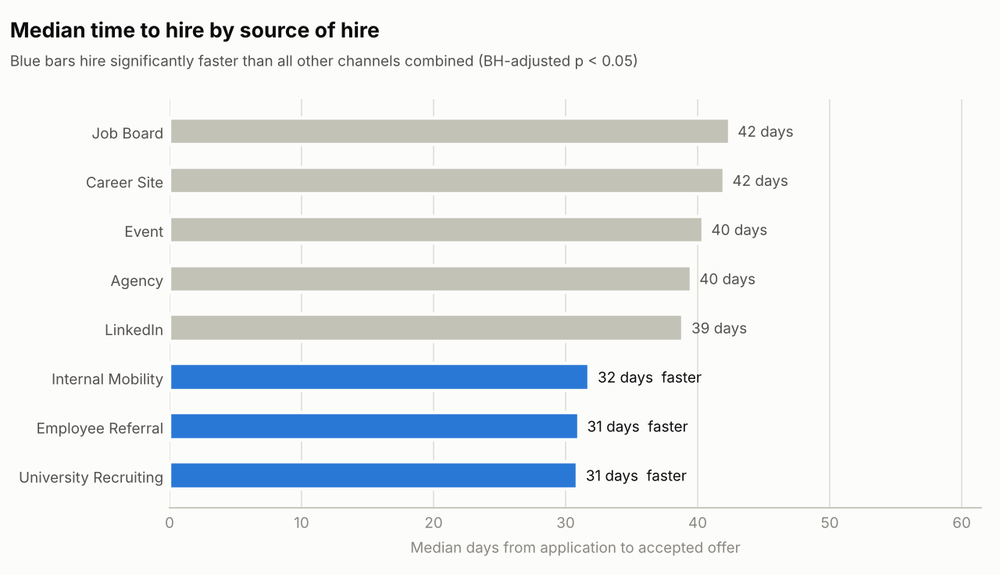

# Recruiting Funnel & Hiring Analytics Platform

**dbt + Snowflake + Tableau** | Python, SQL, GitHub Actions

An end-to-end people analytics pipeline that models a full-cycle recruiting funnel from
simulated Applicant Tracking System (ATS) and HRIS data. It answers the questions a
recruiting team asks every week:

- Where do candidates drop out of the funnel, and does it differ by source or department?
- How long does it take to hire, and which sourcing channels are faster?
- Do offers get accepted, and why not?
- Which channels produce hires who stay past their first year?

The data is simulated (50K+ candidates, 63K+ applications, 175K+ stage events) but carries the
messiness real ATS exports have: inconsistent stage labels, duplicate source names, re-applicants.
The dbt layer cleans that up and tests it, so the Tableau dashboards only refresh on data that
passed.

## Architecture



## What's in the repo

```
data_generator/generate_ats_data.py   simulated ATS + HRIS data (6 tables)
ingestion/load_raw.py                  loads CSVs into Snowflake RAW (or DuckDB for local/CI)
ingestion/snowflake_setup.sql          warehouse, database, roles, PII masking policy
dbt/
  seeds/                               stage + source label mappings (the fix for upstream label drift)
  models/staging/                      6 staging models, source freshness checks
  models/intermediate/                 stage progression pivot, enriched application grain
  models/marts/                        2 facts, 1 dim, 5 reporting marts, docs + Tableau exposure
  macros/                              cross-database helpers and 5 custom generic tests
  tests/                               6 singular tests (reconciliation, ordering, gap checks)
  analyses/recruiter_scorecard.sql     ad hoc recruiter pipeline query
analysis/hiring_stats.py               statistical tests + plain-language report + charts
tableau/                               mart export for Tableau Public + dashboard build guide
tests/                                 pytest unit tests for the generator and the statistics
.github/workflows/ci.yml               CI on every PR (DuckDB), deploy to Snowflake on main / nightly
```

## Quick start (local, no Snowflake account needed)

DuckDB stands in for Snowflake locally. The same dbt models run on both because the SQL uses
dbt's cross-database macros (`dbt.datediff`, `dbt.date_trunc`, `dbt.hash`, ...).

```bash
python -m venv .venv && source .venv/bin/activate
pip install -r requirements-dev.txt

make all        # generate data -> load -> dbt build (90 tests) -> freshness -> stats -> Tableau export
make docs       # browse model docs and lineage at http://localhost:8080
```

Or step by step:

```bash
python data_generator/generate_ats_data.py --out-dir data/raw --candidates 50000
python ingestion/load_raw.py --target duckdb
cd dbt && dbt build --profiles-dir . && cd ..
python analysis/hiring_stats.py --target duckdb
python tableau/export_marts.py --target duckdb
```

## Running on Snowflake

1. Run `ingestion/snowflake_setup.sql` in a Snowsight worksheet (creates the warehouse,
   `PEOPLE_ANALYTICS` database, `TRANSFORMER` and `REPORTER` roles, and an email masking policy).
2. `cp .env.example .env`, fill in your account details, then:

```bash
pip install -r requirements-snowflake.txt
set -a && source .env && set +a
make all TARGET=snowflake
```

dbt writes to `PEOPLE_ANALYTICS.STAGING`, `.INTERMEDIATE`, `.MARTS` and `.REFERENCE`.
Point Tableau at `MARTS` with the `REPORTER` role.

## Data model

| Model | Grain | What it's for |
|---|---|---|
| `fct_applications` | application | Funnel flags per stage, days between stages, offer outcome |
| `fct_hires` | hire | Time to hire, time to fill, tenure, first-year attrition flag |
| `dim_source_channel` | source channel | Canonical channels and categories |
| `mart_recruiting_funnel` | month x dept x level x source x stage | Funnel chart and stage conversion |
| `mart_time_to_hire` | start month x dept x source | Speed KPIs (avg / median days) |
| `mart_offer_acceptance` | month x dept x level x source | Acceptance rate and decline reasons |
| `mart_attrition_by_source` | source x dept | First-year attrition (quality of hire) |
| `mart_requisition_health` | requisition | Days open, applicants, hires, SLA status |

KPI definitions live as dbt doc blocks in `dbt/models/marts/_docs.md` and show up in `dbt docs`.

## Testing

**90 dbt data tests** run on every build:

| Kind | Examples |
|---|---|
| Keys | `unique` / `not_null` on every primary key, source and model |
| Referential integrity | applications -> candidates / requisitions, events -> applications, hires -> HRIS |
| Accepted values / ranges | job levels, statuses, salary bands, conversion rates between 0 and 1 |
| Upstream gap checks | every raw stage and source label must map to a canonical value |
| Business logic | funnel never grows stage over stage, hires reconcile to HRIS, offers answered after extended |
| Freshness | raw tables warn at 24h, error at 48h |

**Catching upstream gaps.** ATS admins add or rename pipeline stages without telling anyone.
When that happens, `stg_ats__stage_events.canonical_stage` comes back null, the tests fail, and
the marts don't rebuild, so Tableau keeps the last good data instead of a funnel with missing
candidates. Try it:

```bash
make gaps
# FAIL 3  assert_no_unmapped_stage_labels          <- lists the new labels to add to the seed
# FAIL 40 not_null_stg_ats__stage_events_canonical_stage
# FAIL 15 relationships_stg_ats__stage_events_application_id  <- orphan events
```

CI runs this check on every PR and fails if the tests *don't* catch the injected gaps.

**Python unit tests** (`pytest tests`) cover the generator's keys and reconciliation, seed
coverage of every generated label, and the statistics code against known answers.

## Results

From `reports/hiring_insights.md` (regenerated on every run):

- **3 channels hire significantly faster:** University Recruiting, Employee Referral and Internal
  Mobility have a median time to hire of about 31 days versus 40 for every other channel combined,
  roughly **20%+ faster** (Mann-Whitney U, Benjamini-Hochberg adjusted p < 0.05).
- **Retention follows a similar pattern:** under 5% of internal moves leave in their first year,
  against roughly a third of job board and agency hires (company-wide: about 16%).
- **Offer acceptance** is flat across channels (77% to 83%, not statistically different), so the
  speed gap comes from interview velocity, not offer stage.



Exact figures shift slightly if you change the generator seed or size.

## CI/CD

`.github/workflows/ci.yml`:

- **Every pull request:** pytest, generate data, `dbt build` on DuckDB with all 90 tests, source
  freshness, the gap-detection check, statistical analysis, `dbt docs generate`. Reports and docs
  are uploaded as build artifacts.
- **Main branch and nightly:** after the DuckDB job passes, the same build runs against Snowflake.
  Enable it by setting the repo variable `SNOWFLAKE_ENABLED=true` and adding `SNOWFLAKE_ACCOUNT`,
  `SNOWFLAKE_USER`, `SNOWFLAKE_PASSWORD` as repository secrets.

## Privacy

Candidate names are dropped in staging and emails are hashed, so no candidate PII reaches the
marts or Tableau. `snowflake_setup.sql` also adds a masking policy on the raw email column.
